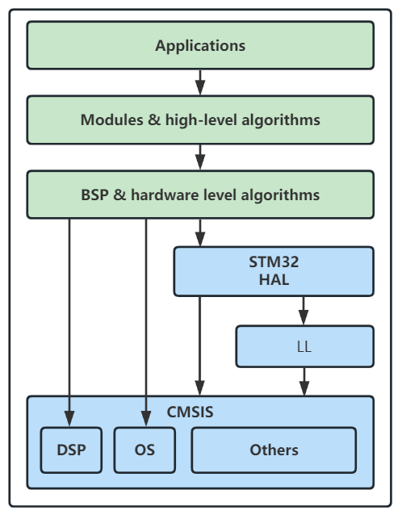

# 软件架构（v0.1 草案）

## 1. 分层

> 分层方式以**考核题给出的参考图**为准（见 `docs/images/01-分层参考.png`）：



| 层 | 职责 | 本工程对应目录 |
|---|---|---|
| **Applications** | 业务逻辑：云台控制、状态机、故障处理 | `app/` |
| **Modules & high-level algorithms** | 器件模块 + 高级算法（PID、姿态解算、滤波） | `module/` |
| **BSP & hardware level algorithms** | 板级封装（UART/I2C/CAN）+ 依赖硬件的换算（如 角度→脉宽） | `bsp/` |
| **STM32 HAL / LL** | 厂商库函数 / 寄存器级宏 | `Drivers/`（CubeMX 生成，不改） |
| **CMSIS** | 内核抽象：DSP 库、RTOS 接口 | `Drivers/CMSIS`（不改） |

分层的作用：增强可移植性，减少换芯片时的工作量。

## 2. 目录

```
firmware/
├── bsp/
│   ├── iuart.hpp / uart_stm32.cpp      阻塞 / 中断 / DMA 三种实现
│   ├── ii2c.hpp  / i2c_stm32.cpp
│   ├── ican.hpp  / can_stm32.cpp
│   └── itimer.hpp
├── module/
│   ├── mpu6050/      姿态解算（DMP + 互补滤波两套，可切换）
│   ├── servo/        舵机（限位、缓启动、死区补偿）
│   ├── btlink/       蓝牙链路 + 帧解析
│   └── logger/       统一日志（RTT / UART 二选一）
├── app/
│   ├── gimbal/       控制环、安全策略、状态机
│   └── main_tasks.cpp  FreeRTOS 任务创建
├── common/           Result / Err / CRC16 / ring buffer
└── Core/             CubeMX 生成（不动）
```

## 3. FreeRTOS 任务划分

| 任务 | 优先级 | 周期 | 栈 | 通信方式 | 为什么 |
|---|---|---|---|---|---|
| `SensorTask` | 4（最高） | 5 ms | 512 B | 队列 → 控制任务 | 姿态采样最怕抖动，必须最高优先级且固定周期 |
| `ControlTask` | 3 | 10 ms | 512 B | 队列 ← 传感器；直接写 PWM | 控制环 100 Hz，晚一点就会影响稳定性 |
| `CommTask` | 2 | 事件驱动 | 512 B | 队列 ← UART ISR；队列 → 发送 | 通信可容忍延迟，但不能阻塞控制 |
| `MonitorTask` | 1（最低） | 100 ms | 256 B | 事件组 | 状态汇总、看门狗喂狗、日志 |

**为什么这样分：**

- 采样与控制分离：控制周期由定时器触发，绝不会因为串口解析而抖动
- 通信优先级最低：蓝牙丢一帧不影响云台稳定
- 全部用**队列**传数据而不是全局变量：避免临界区，数据自带时间戳
- ISR 里只做入队（`xQueueSendFromISR`），解析放到任务里

## 4. 数据流

```
UART ISR ──字节──> RingBuffer ──> CommTask ──解析──> 目标角 / PID 参数
                                                          │
TIM6 中断 ──信号量──> ControlTask ──读──> SensorTask 的最新姿态
                                                          │
                                                      PID 计算
                                                          │
                                                      Servo 输出
                                                          │
                                          TelemetryTask ──> 上位机
```

控制周期用 **TIM6 更新中断 + 二值信号量**触发，不用 `vTaskDelay`——后者会随调度漂移。

## 5. 与考核要求的对应

| 要求 | 落在哪 |
|---|---|
| BSP / Module / App 分层 | 上面第二节 |
| 外设统一接口，业务不碰 HAL | `bsp/iuart.hpp` 等纯虚接口 |
| 至少两种传输方式 | `uart_stm32.cpp` 提供 Blocking / IT / DMA 三个实现 |
| 统一错误码 + 日志 | `common/result.hpp`、`module/logger` |
| 可移植 | BSP 层换一个 `*_stm32f4.cpp` 即可，App/Module 零改动 |
| 定时器触发控制 | TIM6 + 信号量 |
| 安全策略 | `app/gimbal/safety.cpp`：限位、缓启动、失联超时 |

## 6. 待定

- [ ] DMP 与互补滤波：默认 DMP，上位机可切换到自写互补滤波（任务 02 要求说明滤波方案，两套都实现更好写文档）
- [ ] 日志走 RTT 还是 UART：RTT 不占串口，但需要 J-Link 常驻；演示时用 UART 更稳
- [ ] 是否引入 `std::function`（C++17 可用，但会带来堆分配，回调改用函数指针 + void*）
