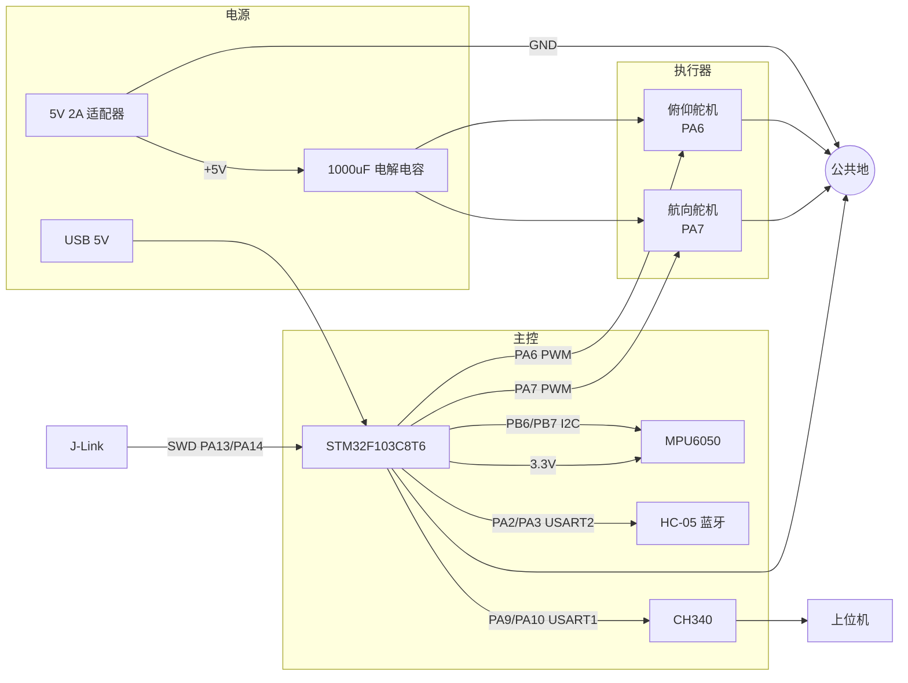

# 电器拓扑

## 1. 拓扑图

## 2. 信号连接表

| 信号 | 引脚 | 对端 | 电平 |
|---|---|---|---|
| 俯仰 PWM | PA6 (TIM3_CH1) | 舵机 1 信号 | 3.3V / 50Hz |
| 航向 PWM | PA7 (TIM3_CH2) | 舵机 2 信号 | 3.3V / 50Hz |
| I2C1 SCL | PB6 | MPU6050 SCL | 3.3V，4.7k 上拉 |
| I2C1 SDA | PB7 | MPU6050 SDA | 3.3V，4.7k 上拉 |
| USART1 TX/RX | PA9 / PA10 | CH340 RX / TX | 3.3V，115200 |
| USART2 TX/RX | PA2 / PA3 | HC-05 RXD / TXD | 3.3V，9600 |
| SWD | PA13 / PA14 | J-Link SWDIO / SWCLK | 3.3V |

## 3. 电流预算

| 设备 | 空载 | 峰值 | 说明 |
|---|---|---|---|
| SG90 ×2 | 0.1 A | **1.4 A** | 堵转时最大 |
| STM32F103 | 0.03 A | 0.05 A | |
| MPU6050 | 0.004 A | 0.005 A | |
| HC-05 | 0.04 A | 0.05 A | |
| **合计** | ~0.2 A | **~1.5 A** | 适配器选 2A，留 30% 余量 |

## 4. 设计说明

**① 舵机独立供电**
SG90 堵转 0.7A/个，两个 1.4A；开发板 USB 限流 500mA。
共用会掉压导致 MCU 复位，所以舵机走独立 5V 适配器。

**② 单点共地**
舵机地、MCU 地、蓝牙地全部汇到适配器负极一点（星型接地）。
地线上有舵机电流流过会产生压降，公共地可以避免信号参考漂移。

**③ 电源端并 1000uF 电容**
吸收舵机启动瞬间的电流冲击，防止 5V 瞬时跌落。

**④ 3.3V 只给传感器和蓝牙**
MPU6050 和 HC-05 的逻辑电平是 3.3V，由板载 LDO 提供。

**⑤ 两种外设走不同串口**
USART1 接 CH340 用于上位机看波形；USART2 接蓝牙用于手机控制。
两个设备不能共用一个 USART（两个 TX 会同时驱动同一根 RX 线）。
